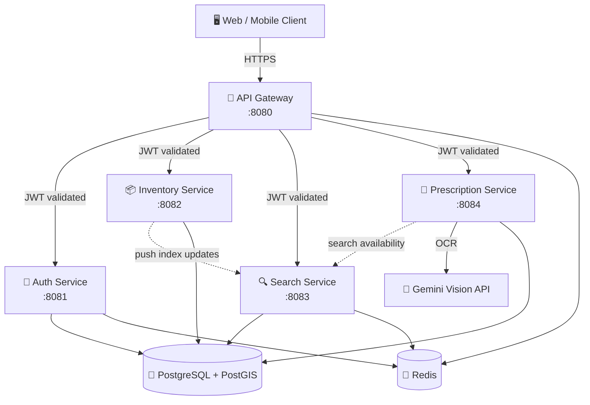

# MediLocator

> Find available medicines at nearby pharmacies. Upload your prescription, let AI extract the medicines, and instantly see which pharmacies around you have them in stock.

MediLocator is a microservices-based platform that combines **geospatial search**, **AI-powered prescription OCR**, and **fuzzy medicine matching** to solve a real problem: patients walking from pharmacy to pharmacy looking for medicines that may or may not be in stock.

---

## Table of Contents

- [Key Features](#key-features)
- [Architecture](#architecture)
- [Tech Stack](#tech-stack)
- [Project Structure](#project-structure)
- [Prerequisites](#prerequisites)
- [Quick Start](#quick-start)
- [Configuration](#configuration)
- [API Endpoints](#api-endpoints)
- [Services Overview](#services-overview)
- [Development Workflow](#development-workflow)
- [Roadmap](#roadmap)
- [License](#license)

---

## Key Features

- **Geospatial medicine search** — find pharmacies within a radius using PostGIS `ST_DWithin`
- **Fuzzy matching** — handles typos via PostgreSQL `pg_trgm` trigram similarity
- **AI prescription extraction** — Gemini Vision 2.x parses prescription images into structured medicine lists
- **Role-based access** — Customer, Pharmacy, and Admin roles with JWT authentication
- **Pharmacy approval workflow** — admins vet pharmacy registrations before they go live
- **Real-time inventory sync** — when a pharmacy updates stock, the search index updates automatically
- **API Gateway** — single entry point with rate limiting, CORS, and circuit breakers

---

## Architecture

MediLocator is built as **five independent microservices** behind an API Gateway, each owning its own domain.



### Request flow example — "Find Paracetamol near me"

1. Client sends `GET /api/search?query=paracetamol&lat=9.01&lng=38.76&radiusKm=5` to the gateway
2. Gateway validates the JWT, forwards to **Search Service**
3. Search runs a PostGIS + pg_trgm query, returns ranked pharmacies
4. Result cached in Redis for the next identical query

### Request flow — "Upload a prescription"

1. Client uploads image to `POST /api/prescriptions/upload`
2. **Prescription Service** stores the image, calls **Gemini Vision**
3. Gemini returns structured JSON with extracted medicine names
4. Prescription Service fuzzy-matches names against the Inventory database
5. Matched medicines are forwarded to **Search Service** for nearby availability
6. Final response combines extracted medicines + nearby pharmacies

---

## Tech Stack

| Layer | Technology |
|---|---|
| Language | Java 21 |
| Framework | Spring Boot 3.3 |
| Build | Maven (per-service) |
| API Gateway | Spring Cloud Gateway 2023.0 |
| Database | PostgreSQL 16 + PostGIS 3.4 + pg_trgm |
| Cache / Session | Redis 7 |
| Authentication | JWT (HS512, JJWT 0.12.5) |
| OCR | Google Gemini Vision 2.x (primary) / Cloud Vision (fallback) |
| Fuzzy matching | Apache Commons Text |
| Resilience | Resilience4j (circuit breaker, rate limiting) |
| Containerization | Docker + Docker Compose |
| Env management | `spring-dotenv` + `dotenv-java` |

---

## Project Structure

```
MediLocator/
├── gateway/              # API Gateway (port 8080)
├── auth/                 # Authentication & user management (port 8081)
├── inventory/            # Pharmacy medicine catalog (port 8082)
├── search/               # Geospatial + fuzzy medicine search (port 8083)
├── prescription/         # Prescription upload + OCR (port 8084)
├── uploads/              # Local prescription storage (dev only)
├── docker-compose.yml    # Full stack orchestration
├── .env.example          # Template — copy to .env and fill in values
└── README.md
```

Each service follows **Clean Architecture / DDD layering**:

```
src/main/java/com/medicinelocator/<service>/
├── domain/               # Entities, value objects, domain exceptions
├── application/          # Commands, queries, handlers (CQRS)
├── infrastructure/       # Persistence, external clients, security
└── presentation/         # REST controllers, DTOs
```

---

## Prerequisites

- **Java 21+** ([Eclipse Temurin](https://adoptium.net/) or Oracle JDK)
- **Maven 3.9+** (or use the included `./mvnw` wrapper)
- **Docker + Docker Compose** (recommended) **OR** local PostgreSQL 16 + Redis 7
- **Google AI Studio API key** for Gemini ([get one free](https://aistudio.google.com/app/apikey))

---

## Quick Start

### Option A — Docker Compose (recommended)

```bash
# 1. Clone the repo
git clone https://github.com/edenmersha2127-byte/pharmahub.git
cd pharmahub

# 2. Create your .env from the template
cp .env.example .env
# Edit .env and fill in real values (DB password, JWT secret, Gemini API key, etc.)

# 3. Start everything
docker-compose up --build
```

All services will be available at:

| Service | URL |
|---|---|
| API Gateway | http://localhost:8080 |
| Auth | http://localhost:8081 |
| Inventory | http://localhost:8082 |
| Search | http://localhost:8083 |
| Prescription | http://localhost:8084 |

Verify with `curl http://localhost:8080/actuator/health` → `{"status":"UP"}`

### Option B — Local development (IntelliJ)

1. Start dependencies:
   ```bash
   docker-compose up postgres redis
   ```
2. Open the project in IntelliJ
3. For **each** service's Run Configuration:
   - Set **Working directory** to the repo root (`MediLocator/`), not the service folder
   - This ensures `spring-dotenv` finds the root `.env`
4. Run the 5 services in this order: `auth → inventory → search → prescription → gateway`

---

## Configuration

All secrets and environment-specific values live in `.env` (gitignored). Use `.env.example` as a template.

| Variable | Purpose | Example |
|---|---|---|
| `POSTGRES_USER` / `POSTGRES_PASSWORD` / `POSTGRES_DB` | Database credentials | `postgres / strongpassword / medicine_locator_db` |
| `REDIS_PASSWORD` | Redis auth | `change_me` |
| `JWT_SECRET` | HMAC key for JWT signing (≥ 64 chars, base64) | `eyJhbGc...` |
| `JWT_ACCESS_TOKEN_EXPIRATION` | Access token TTL (ms) | `900000` (15 min) |
| `JWT_REFRESH_TOKEN_EXPIRATION` | Refresh token TTL (ms) | `604800000` (7 days) |
| `SPRING_MAIL_HOST` / `SPRING_MAIL_USERNAME` / `SPRING_MAIL_PASSWORD` | SMTP for email verification | Gmail SMTP + app password |
| `GEMINI_API_KEY` | Google AI Studio key | `AIzaSy...` |
| `GEMINI_MODEL` | Gemini model name | `gemini-2.0-flash` |
| `GOOGLE_VISION_API_KEY` | Fallback OCR provider | `AIzaSy...` |
| `OCR_PROVIDER` | `gemini_vision` \| `google_vision` \| `mock` | `gemini_vision` |
| `AUTH_SERVICE_URL` ... | Service-to-service URLs (local) | `http://localhost:8081` |

> **Never commit `.env`.** It contains real secrets. Always commit `.env.example` with placeholders.

---

## API Endpoints

### Authentication (`/api/auth`)
| Method | Path | Description |
|---|---|---|
| `POST` | `/api/auth/register/customer` | Register a customer |
| `POST` | `/api/auth/register/pharmacy` | Register a pharmacy (pending admin approval) |
| `POST` | `/api/auth/login` | Authenticate, returns access + refresh JWT |
| `POST` | `/api/auth/refresh` | Get new access token using refresh token |
| `POST` | `/api/auth/logout` | Blacklist the current access token |
| `GET` | `/api/auth/verify-email?token=...` | Verify email address |
| `POST` | `/api/auth/forgot-password` | Send password reset link |
| `POST` | `/api/auth/reset-password` | Reset password with token |

### Admin (`/api/admin`)
| Method | Path | Description |
|---|---|---|
| `GET` | `/api/admin/pharmacies?status=PENDING` | List pending pharmacy registrations |
| `POST` | `/api/admin/pharmacies/{id}/approve` | Approve pharmacy |
| `POST` | `/api/admin/pharmacies/{id}/reject` | Reject pharmacy |

### Inventory (`/api/inventory`)
| Method | Path | Description |
|---|---|---|
| `POST` | `/api/inventory/medicines` | Add medicine to pharmacy's catalog |
| `PUT` | `/api/inventory/medicines/{id}` | Update stock/price |
| `DELETE` | `/api/inventory/medicines/{id}` | Remove medicine |
| `GET` | `/api/inventory/pharmacy/{pharmacyId}` | List pharmacy's medicines |

### Search (`/api/search`)
| Method | Path | Description |
|---|---|---|
| `GET` | `/api/search?query=paracetamol&lat=9.01&lng=38.76&radiusKm=5` | Find medicines near a location |
| `GET` | `/api/search/nearby?lat=...&lng=...&radiusKm=...` | List nearby pharmacies |
| `POST` | `/api/search/prescription` | Batch search (called internally by Prescription service) |

### Prescription (`/api/prescriptions`)
| Method | Path | Description |
|---|---|---|
| `POST` | `/api/prescriptions/upload` | Upload prescription image (multipart) |
| `GET` | `/api/prescriptions/{id}` | Get prescription details + extracted medicines |
| `GET` | `/api/prescriptions/customer/{customerId}` | List customer's prescriptions |

> Once Swagger is wired into all services, interactive docs will be at `http://localhost:<port>/swagger-ui.html`.

---

## Services Overview

### Gateway (`:8080`)
Single entry point. Validates JWT, injects `X-User-Id` / `X-User-Role` headers, routes by path, applies rate limiting (Redis-backed), CORS, and circuit breakers.

### Auth Service (`:8081`)
Owns `customers`, `pharmacies`, `admins`, `refresh_tokens`. Issues JWTs, sends verification emails via SMTP, handles pharmacy approval workflow.

### Inventory Service (`:8082`)
Owns `medicines`. Each pharmacy manages its own catalog. On every change, pushes an index update to the Search Service so search results stay in sync.

### Search Service (`:8083`)
Owns `medicine_search_index` — a denormalized table with pharmacy info + geolocation. Combines `pg_trgm` similarity (fuzzy matching) with PostGIS `ST_DWithin` (proximity). Caches frequent queries in Redis.

### Prescription Service (`:8084`)
Owns `prescriptions`, `prescription_items`. Workflow: receive image → store locally → call Gemini Vision → parse JSON → fuzzy-match extracted names against inventory → forward to Search for availability.

---

## Development Workflow

### Running tests

```bash
# Per service
cd auth && ./mvnw test
```

### Building a single service

```bash
cd auth && ./mvnw clean package
```

### Hot-reload during development

Use Spring Boot DevTools (already in dependencies). Files compile-on-save in IntelliJ → app restarts in ~3 seconds.

### Code conventions

- **CQRS** — every write goes through a `Command + CommandHandler`, every read through `Query + QueryHandler`
- **DDD layering** — domain doesn't depend on infrastructure; controllers don't talk to repositories directly
- **No business logic in controllers** — they only parse input and call handlers

---

## Roadmap

- [ ] Replace shared PostgreSQL with per-service databases
- [ ] Message queue (RabbitMQ / Kafka) for inventory → search sync
- [ ] Cloud storage (S3 / MinIO / R2) for prescription uploads
- [ ] Flyway database migrations (replace `ddl-auto: update`)
- [ ] OpenAPI / Swagger UI on all 5 services
- [ ] Integration test suite per service
- [ ] Prometheus + Grafana monitoring
- [ ] Frontend (React + Vite) — currently a separate repo
- [ ] Multi-language support (English, Amharic, etc.)
- [ ] Predictive stock recommendations based on demand patterns

---

## Security

- All API keys, DB passwords, and JWT secrets live in `.env` (gitignored)
- JWT tokens are blacklisted in Redis on logout
- Gateway validates every JWT before forwarding requests
- Downstream services trust gateway-injected headers — direct access is blocked by network policy (in production)
- File uploads are restricted to JPG/PNG/PDF, max 10 MB

> **Disclosure:** during development, several secrets were committed in earlier git history. All such keys have been **rotated**. Old keys are no longer valid.

---

## License

This project is provided as-is for educational and portfolio purposes. Choose a license (MIT / Apache 2.0 / GPL) before deploying publicly.

---

## Acknowledgments

- [Spring Boot](https://spring.io/projects/spring-boot) — the foundation
- [PostGIS](https://postgis.net/) — geospatial queries
- [Google AI Studio](https://aistudio.google.com/) — Gemini Vision OCR
- [Resilience4j](https://resilience4j.readme.io/) — circuit breakers
